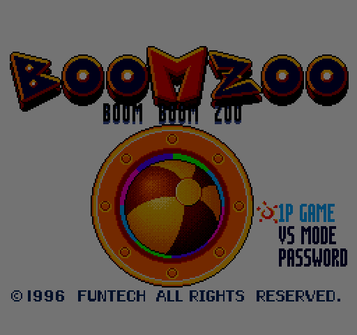
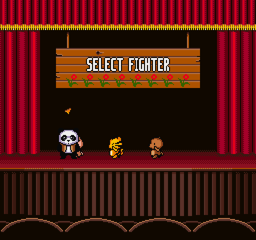
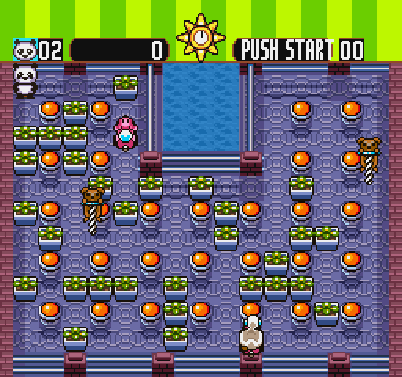
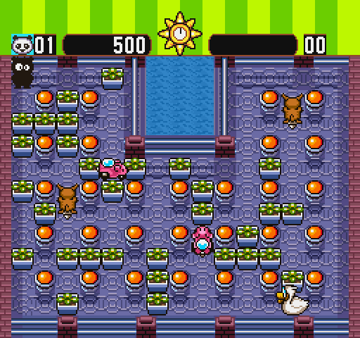

# Boom Zoo (Super A'Can) — English VWF Localization

Reproducible English translation and Variable-Width Font (VWF) graphics localization pipeline for **Boom Zoo** (*Boom Zoo (Taiwan).bin*, Super A'Can / Funtech 1996, M68000).

## Screenshots

<p>




</p>

## How to Play

| Patch | Apply to | Result |
|---|---|---|
| `build/Boom Zoo (EN).ips` | `Boom Zoo (Taiwan).bin` / MAME `boomzoo` `boomzoo.bin` (524,288 bytes, CRC32 `6099bb44`, SHA-1 `0b5fbe2117bb77a827453c5489b3af691e5c7ade`) | 1,048,576 bytes, SHA-1 `80259a3e15ba8e9294cc14baae235fc4b302f275` |

The patch grows the ROM to 1 MB (the new graphics live in the second half).

- **Repo emulator:** open the patched file.
- **MAME:** load it as a loose cartridge: `mame supracan -cart "Boom Zoo (EN).bin"`. Don't put it in
  the `boomzoo` software-list folder: that entry is 512 KB, so MAME cuts the file in half and the
  screen stays black.

## Key Technical Notes

- **Zero native 1bpp/ASCII string table:** All Traditional Chinese UI text in the original ROM is pre-rendered into 4bpp BG/sprite tiles and tilemap layouts compressed with Boom Zoo's `$002B22` routine (no script string table exists).
- **ROM format & 1 MB expansion:** Hardware/emulator `.bin` dumps are `524,288` bytes (512 KB) in 16-bit byte-swapped order relative to 68000 big-endian execution. [`tools/boom_rom.py`](tools/boom_rom.py) swaps on load, expands the ROM to `1,048,576` bytes (1 MB, `0xFF`-padded) to house relocated compressed assets in `0x080000..0x08A0EF` (`41,196 / 524,288` expansion bytes used across `14` blocks and `123` verified non-overlapping fixed/pointer patches), and writes both the byte-swapped English ROM and a byte-exact IPS patch.
- **`$002B22` compression engine ([`tools/d222.py`](tools/d222.py)):** Exact Python implementation of Boom Zoo's `$002B22` (`$D222`-family) decompressor (`MAX_DECOMP_SIZE = 0x9480`, ROM tables at `0x002F9C` and `0x002E2A`, supporting `0xF0` raw, `0xF1` RLE, and `0xF3`/`0xF4` LZ+Huffman) paired with `encode_d222_best` for verified round-trip recompression.
- **Variable-Width Font (VWF) pipeline ([`tools/vwf.py`](tools/vwf.py)):** Proportional glyph sheets (`font_vwf_banner` `12×20`, `font_vwf_display` `10×16` extended with `?`, and `font_vwf_body` `8×12`) are styled per screen to match original 4bpp hardware palettes (solid, directional drop-shadow, outlined, beveled HUD banners, and carved gold headers) and packed into deduplicated (H/V-flip-aware) 8×8 4bpp tiles strictly within each target's freed/unused tile pool (`TileBankAllocator`).

## Localized & Preserved Screens

| Target / Screen | Changes Applied | Tile Budget |
| :--- | :--- | :--- |
| **Title (`title_sprites`)** | `"BOOM BOOM ZOO"` subtitle positioned cleanly above the porthole (`fid=19, 19, 20`) + `"1P GAME"`, `"VS MODE"`, `"PASSWORD"` menu sprites widened to `8×2` with updated cursor/OAM tables | `50 / 56` free (`nt=527`) |
| **1P Character Select (`char_select_1p`)** | `"SELECT FIGHTER"` outlined white header (`Pal 13`) centered across the wooden sign with background wood grain and all 8 flowers preserved | `23 / 24` free (`nt=64`) |
| **Gameplay HUD (`hud_sprites`)** | `"JOIN IN!"` (`fid=237`), `"PUSH START"` (`fid=238`), beveled gold `"PAUSED!"` (`fid=239..242` + preserved `!` `248`), and gold/white-blink `"HURRY UP!"` (`fid=243..247`, `249..253` + `248`/`254`), with all 44 map & 44 gfx pointers updated | `129 / 140` free (`nt=247`) |
| **Continue (`continue_sprites`)** | `"CONTINUE?"`, `"NO"`, `"YES"` inside speech bubble (`fid=6`) with outer border intact and updated cursor Y positions | `17 / 22` free (`nt=48`) |
| **VS Setup (`vs_setup_bg`)** | Carved gold headers `"PLAYERS"`, `"CHARACTERS"`, and `"ROUNDS"` (`Pal 13`) | `80 / 90` free (`nt=125`) |
| **VS Stage Select (`vs_stage_select_spr`)** | Carved gold `"SELECT STAGE"` (`fid=0`, `<= 104 px` wide to clear the stage digit) | `32 / 35` free (`nt=127`) |
| **VS Results (`vs_results_bg`)** | Carved gold `"RESULTS"` centered inside the double-bordered plaque (already-English `"VICTOR!"` at `0x04A5B2` untouched) | `26 / 27` free (`nt=65`) |

### Intentionally Untouched (Already English / Autographs)

- **Intro Cutscene**, **Title Background** (`BOOM ZOO` logo & `© 1996 FUNTECH ALL RIGHTS RESERVED.`), **Password Entry** (`PASSWORD`), **Game Over** (`GAME OVER`), and **VS Match Winner** (`VICTOR!`) are already in English in the original ROM.
- **Ending Credits (`State 1`)** use English role headers (`DESIGNED BY`, `GRAPHIC DESIGN`, `MUSIC`, `SOUND EFFECT`, `GNEST`, `PROGRAM`); adjacent Chinese brush signatures are developer autographs and are preserved unmodified.

## Project Structure

```text
boom-zoo/
├── README.md
├── build/
│   ├── Boom Zoo (EN).bin            # Built 1 MB byte-swapped English ROM
│   ├── Boom Zoo (EN).ips            # IPS patch vs Boom Zoo (Taiwan).bin
│   └── report.txt                   # Build allocation, checksum, & tile summary
├── notes/
│   ├── text_inventory.md            # Complete ROM text/graphics audit & offsets
│   ├── translations_en.json         # Finalized English UI strings
│   ├── font_vwf_banner.{png,json}   # 18px heavyweight arcade banner font (12x20 cell)
│   ├── font_vwf_display.{png,json}  # 14px bold condensed font (10x16 cell, with '?')
│   └── font_vwf_body.{png,json}     # 8x12 proportional font (8x12 cell)
└── tools/
    ├── build_rom.py                 # End-to-end ROM + IPS builder & verifier
    ├── patchers.py                  # Screen-specific VWF tile/map/OAM/code patchers
    ├── vwf.py                       # Bitmap font loader, stylers, & tile deduplicator
    ├── d222.py                      # Boom Zoo $002B22 decompressor & encoder
    └── boom_rom.py                  # Endianness conversion, allocators, IPS I/O, codecs
```

## Build & Verification

Run the builder with Python 3 (requires Pillow / `PIL`):

```bash
python3 tools/build_rom.py
```

Put your own `Boom Zoo (Taiwan).bin` in this folder. The script reads it (never modifying it) and outputs `build/Boom Zoo (EN).bin`, `build/Boom Zoo (EN).ips`, and `build/report.txt`, asserting non-overlapping allocations, `apply_ips(orig, ips) == built ROM` byte equality, and source SHA-1 invariance. All 7 localized blocks were additionally verified visually in the Super A'Can emulator harness (plus live-palette HUD sprite sheet verification for `JOIN IN!` / `PUSH START`).

### Checksums & Build Output

- **Source ROM (`Boom Zoo (Taiwan).bin`):**
  `524,288` bytes (`SHA1: 0b5fbe2117bb77a827453c5489b3af691e5c7ade`, `SHA256: 090827d00ef8047d2c78cc173d258565b1c3ab01f0d97dc3ed8e08833d370077`)
- **Output ROM (`build/Boom Zoo (EN).bin`):**
  `1,048,576` bytes (`SHA1: 80259a3e15ba8e9294cc14baae235fc4b302f275`, `SHA256: 5762ecaef337c9ffedc8411b72f3a8e1ba8a7832a7bd8759372e17166555d7dc`)
- **IPS Patch (`build/Boom Zoo (EN).ips`):**
  `525,359` bytes (`SHA1: 44a1310b3998a8838afb4647ff27e24398bae34d`, `SHA256: 9fa9884d3c1d0f7e1aaba684419e7a2046d1ed6ce9f52a2191334b8a9fd0e2c3`, IPS round-trip: `PASS`)

## License

The tools, fonts and patch are MIT-licensed (see `LICENSE`). The game itself is not included;
you need your own dump.
